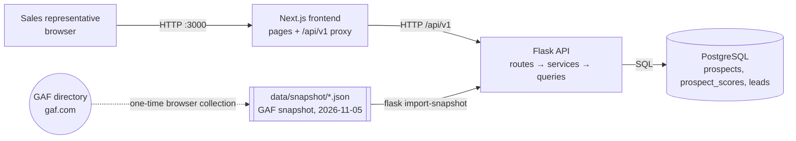
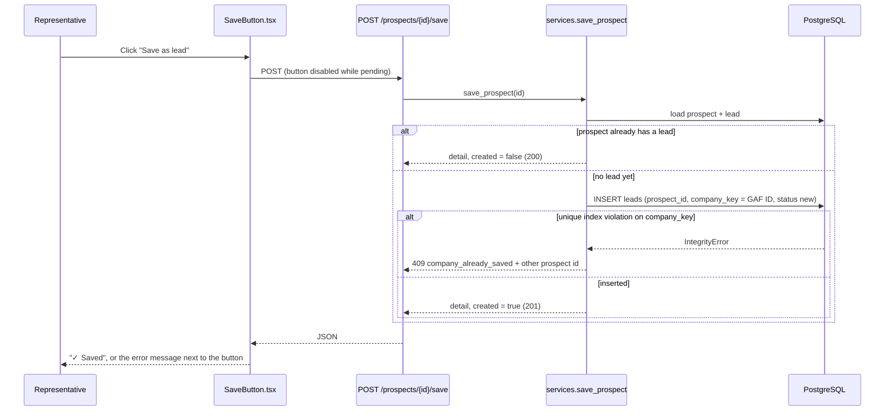
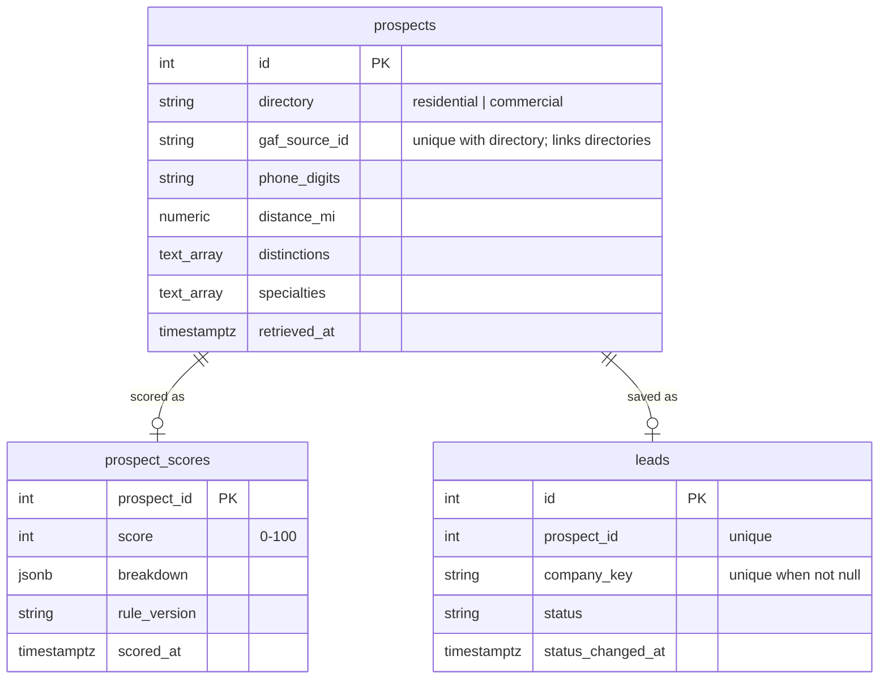

# Architecture and Design

This guide explains the implemented code of Roofing Lead Intel for a software engineer who must maintain it or explain it. It describes the code as of 2026-11-05. Statements marked **Inferred** or **Proposed** are not implemented facts.

## 1. Purpose and scope

**Problem.** Sales representatives of a roofing-materials distributor research roofing contractors by hand before account-planning calls.

**Users.** Distributor sales representatives. There is one shared workspace and no login.

**Main workflows.**

1. Review prospects: filter and sort GAF listings, and read why each listing has its score.
2. Open a prospect: read GAF facts, the score breakdown and the unknown information.
3. Save a prospect as a lead. Its status starts as New.
4. Work the Saved leads call lists: **Needs first contact** (status New) and **Follow-up due** (Contacted 14 or more days ago). Mark a lead contacted from its row.
5. Change the lead status: New, Contacted, Qualified or Dismissed.
6. Use the **Sales dashboard** (the home page, `/`) to choose whom to call next and whom to follow up.

**Implemented requirements.**

- Data from the GAF residential and commercial directories, ZIP 10013, 50 mi, collected one time and stored in files: 176 residential and 233 commercial listings (409 prospects), each file complete against the total GAF showed.
- Import with validation, normalization and duplicate prevention.
- A deterministic score with a visible breakdown.
- One saved lead for each company.
- Status changes that persist after a reload and a restart (manual check, see `docs/BUILD_PROGRESS.md`).
- Consistent JSON errors and request validation.

**Limits of the MVP.**

- There are no live calls to GAF. The data is a snapshot from 2026-11-05.
- Notes and AI insights are deferred (decisions D10 and D11).
- There is no login, so every user sees and changes the same leads.
- No status history is kept. The Sales dashboard shows current counts only.

## 2. Technology stack

| Tool | Responsibility here |
| --- | --- |
| Flask 3 | HTTP API, app factory, blueprint, CLI commands |
| SQLAlchemy 2 | Table models, queries, transactions |
| PostgreSQL 16 | Storage, unique constraints, check constraints |
| psycopg 3 | PostgreSQL driver |
| Pydantic 2 | Validation of query strings, request bodies, responses and snapshot files |
| gunicorn | Backend server in the container (2 workers, 4 threads each) |
| Next.js 14 (App Router) | Frontend pages and the `/api/v1` proxy |
| React 18, TypeScript | UI components and types |
| Tailwind CSS 3 | Styling with semantic pastel tokens |
| openapi-typescript, openapi-fetch | Types generated from `openapi.yaml` and a typed API client |
| Docker Compose | Runs `db`, `backend` and `frontend` locally |

## 3. Directory structure

```text
roofing-lead-intel/
├── docker-compose.yml        # db, backend, frontend services and ports
├── openapi.yaml              # API contract (source for frontend types)
├── .env.example              # configuration names, no secrets
├── data/snapshot/            # GAF snapshot JSON files (the only data source)
├── backend/
│   ├── wsgi.py               # entry point for gunicorn
│   └── app/
│       ├── __init__.py       # create_app(): config, DB, errors, blueprint, CLI
│       ├── config.py         # environment variables
│       ├── db.py             # engine, per-request session, table creation
│       ├── models.py         # prospects, prospect_scores, leads
│       ├── schemas.py        # Pydantic request and response models
│       ├── errors.py         # ApiError and the JSON error shape
│       ├── api/__init__.py   # routes under /api/v1
│       ├── services.py       # business rules and response building
│       ├── queries.py        # feature-specific SQL reads
│       ├── scoring.py        # score rule version v1
│       ├── cli.py            # flask import-snapshot, flask rescore
│       └── collection/
│           ├── snapshot.py   # snapshot file validation
│           └── importer.py   # normalize, upsert, rescore
├── frontend/
│   ├── app/                  # pages: / (Sales dashboard), /prospects, /prospects/[id], /leads
│   ├── components/ui/        # shared UI: badges, KPI cards, bar lists, fields, states
│   ├── components/leads/     # lead-specific UI: badges, SaveButton, StatusSelect
│   ├── lib/api.ts            # typed client and error helpers
│   ├── lib/api-types.ts      # generated from openapi.yaml (do not edit)
│   ├── lib/useLoad.ts        # data loading that ignores late responses
│   └── next.config.mjs       # /api/v1 proxy to Flask
├── additional/insights/      # deferred AI insight draft, not connected
└── docs/                     # this guide, diagrams, records, operations
```

**Entry points.** `backend/wsgi.py` (API), `backend/app/cli.py` (import), `frontend/app/layout.tsx` (UI shell).

## 4. Architecture



- **Real services:** PostgreSQL, Flask, Next.js.
- **Local data source:** the snapshot files. The app never calls gaf.com. The dashed arrow is a manual step that happened one time before the import.
- **Module rule:** route handlers in `api/__init__.py` validate input and call `services.py`. Services apply rules and call `queries.py` or the models. Only `collection/` reads snapshot files.
- **Proxy:** the browser calls `/api/v1/...` on port 3000. `frontend/next.config.mjs` forwards these calls to `http://backend:5000`. This removes the need for CORS (D15).

## 5. Request and data flows

### Endpoint inventory

| Method and path | Purpose | Input | Output | Errors | Frontend caller |
| --- | --- | --- | --- | --- | --- |
| `GET /api/v1/health` | Liveness and database check | — | `{status: "ok"}` | 500 | None (manual checks only) |
| `GET /api/v1/overview` | Pipeline summary | `directory` | `Overview` | 422 | `app/page.tsx` |
| `GET /api/v1/prospects` | Filtered, sorted, paged prospects | `q, directory, tier, max_distance, state, cert_tier, hide_saved, sort, page, page_size` | `ProspectList` | 422 | `app/prospects/page.tsx` |
| `GET /api/v1/prospects/stats` | KPI and chart counts | `directory` | `ProspectStats` | 422 | `app/prospects/page.tsx`, `components/ui/layout/Sidebar.tsx` |
| `GET /api/v1/prospects/{id}` | Prospect detail | path `id` | `ProspectDetail` | 404 | `app/prospects/[id]/page.tsx` |
| `POST /api/v1/prospects/{id}/save` | Save as lead | path `id` | `ProspectDetail` (201 new, 200 already saved) | 404, 409 `company_already_saved` | `components/leads/SaveButton.tsx` |
| `GET /api/v1/leads` | Saved leads, status counts and call-list counts | `q, scope (active/all/dismissed), status (new/contacted/qualified), queue (first_contact/follow_up_due), directory, tier, sort (priority/recently_saved/oldest_status_change), page, page_size` | `LeadList` | 422 | `app/leads/page.tsx` |
| `POST /api/v1/leads/{id}/status` | Change status (PATCH returns 405, D25) | body `{status}` | `ProspectDetail` | 404, 405 for PATCH, 422 | `components/leads/StatusSelect.tsx`; Mark contacted in `app/page.tsx` (Call next) and `app/prospects/[id]/page.tsx` |

Every error uses one shape, made in `backend/app/errors.py`:

```json
{"error": {"code": "validation_error", "message": "The request is not valid.", "details": {"fields": {"status": "Input should be 'new', 'contacted', 'qualified' or 'dismissed'"}}}}
```

### Flow: list prospects

1. `ProspectsView` (`frontend/app/prospects/page.tsx`) reads the filters from the URL. A filter change calls `router.replace`, so the Back button keeps the list state.
2. `useLoad` (`frontend/lib/useLoad.ts`) calls `api.GET("/prospects")` with an `AbortSignal`. A newer request cancels the older one, and a late response is ignored.
3. `list_prospects` route → `ProspectQuery.model_validate` (422 on bad input) → `services.list_prospects` → `queries.prospect_page`.
4. `prospect_page` joins `prospects`, `prospect_scores` and `leads`, applies the filters, counts the total, and orders by `_order` (score, distance, name, id).
5. `services.summarize_prospects` adds the one-line reason (`scoring.top_reason`), the other-directory listing (`queries.twins`) and "saved via" data (`queries.saved_leads_by_key`).

### Directory filter

All three views have a **DirectoryToggle** (`components/leads/DirectoryToggle.tsx`): All directories, Residential or Commercial. The value is in the URL as `directory`. The backend applies it in SQL with `queries._in_directory` for `prospect_page`, `all_leads`, `stats`, `top_unsaved` and `count_high_unsaved`. The counts on each view then describe the chosen directory. `ProspectStats.directories` always covers both directories, so the toggle can show both counts. An empty value (`?directory=`) means no filter (`schemas.QueryModel`, D20).

### Flow: save a prospect



The unique indexes decide a race between two saves. One request inserts. The other request gets an `IntegrityError` and returns 200 (same prospect) or 409 (the company is saved through its other listing).

### Flow: change status

`StatusSelect.tsx` sets the new value at once, sends `POST /leads/{id}/status`, and returns to the old value if the request fails. `services.update_status` changes `status_changed_at` only when the status really changes. The Overview "Mark contacted" button uses the same endpoint.

### Flow: saved leads

1. `LeadsView` (`frontend/app/leads/page.tsx`) keeps `scope`, `status`, `queue`, `directory`, `tier`, `sort` and `page` in the URL.
2. `services.list_leads` loads all saved leads (`queries.all_leads`), builds `LeadSummary` rows with `_lead_summary`, and filters in this order: scope, queue, status, search, directory, tier. Then it sorts with `LEAD_SORTS` and slices the page.
3. `status_counts`, `queue_counts` and `total_saved` describe **all** saved leads. `total` describes the filtered rows. The UI labels the cards "All saved leads" and shows "X matching leads" above the table.
4. Each row shows the distance, reason chips (`top_reason`), a "Follow-up due" badge, the phone link and the status dropdown. A status change shows its success or failure text in that row. **Mark contacted** is not in this table (user decision D23); it is on the lead page for New leads.
5. Below 768 px wide, the table changes to compact cards with the same actions.

`services.overview` uses the same `_lead_summary` and `is_follow_up_due`. **Inferred reason for filtering in Python:** the saved set is small (one representative's leads), and the follow-up rule is time-based. A large shared deployment would move these filters into SQL (see section 10).

## 6. Data design



| Table | Source of truth | Key constraints |
| --- | --- | --- |
| `prospects` | GAF snapshot. A new import replaces the GAF columns. | `uq_prospect_listing` on (`directory`, `gaf_source_id`); `directory` check |
| `prospect_scores` | Derived by `scoring.py` from `prospects` | `score` between 0 and 100 |
| `leads` | Representative actions | `prospect_id` unique; partial unique index on `company_key`; `status` check |

- **Snapshot files** (`data/snapshot/*.json`): a header (directory, ZIP, radius, `expected_total`, `collected_at`, method) and one record for each listing. They are real GAF data, not fixtures.
- **Browser memory only:** filter values (also in the URL), loading and error states, and short status messages. No browser storage is used.
- **Not stored:** raw GAF HTML, search rank, employee range and license number (cut in the design review).

## 7. Business rules

### Normalization and duplicates (`collection/importer.py`)

- `phone_digits` keeps the 10 US digits, or `None`.
- Text fields collapse white space. `address` joins street, city, state and ZIP when a street exists.
- Distinctions and specialties are trimmed, made unique and sorted.
- The upsert key is (`directory`, `gaf_source_id`). A second import updates rows and inserts none. Observed: "0 new, 176 updated".
- `flask import-snapshot` rescores only the imported prospects (`rescore_all(..., prospect_ids)`). `flask rescore` recalculates all (D21).
- An invalid record is reported and skipped. The valid records still import.
- A run is "complete" only when valid records equal the total that GAF showed and no record is invalid.

### Score rule version v1 (`scoring.py`)

| Category | Points |
| --- | --- |
| Distance from ZIP 10013 | ≤10 mi: 35, ≤25 mi: 22, ≤50 mi: 10, unknown: 0 |
| GAF certification tier | Top (President's Club, Master Elite, Chairman's Circle, PlatinumElite): 20; Certified (Certified, GoldElite, CoatingsPro): 12; none: 0 |
| Roof systems | Residential listing: 10; commercial with technologies listed: 10; else 0 |
| Specialty | FORTIFIED, metal, solar or coatings: 5 |
| Phone | 10 |
| Website | 10 |
| Full address | 5 |
| Freshness | Retrieved ≤30 days before the effective time: 5 |

- Tiers: High ≥70, Medium 45–69, Low <45 (`tier_for`).
- Missing data gives 0 points and `unknown: true`. The UI shows these in amber as "Unknown".
- Ratings, reviews and search rank are not scored.
- The effective time is an explicit argument. `flask rescore` recalculates with the current time. Without a rescore, the freshness points stay as they were at import.
- No AI output exists in this version, so every value in the UI is GAF data or a deterministic calculation.

### Worked example (real record, prospect 20)

Redline Enterprises LLC, residential, 38.0 mi, phone listed, no website, full address, distinctions FORTIFIED Roof™, GAF Master Elite®, President's Club.

| Category | Points | Reason |
| --- | --- | --- |
| Distance | 10 | 38.0 mi is in the ≤50 mi band |
| Certification | 20 | Master Elite is top tier |
| Roof systems | 10 | Residential listing |
| Specialty | 5 | FORTIFIED Roof™ |
| Phone | 10 | Listed |
| Website | 0 | Unknown |
| Address | 5 | Street, city and state listed |
| Freshness | 5 | Retrieved the same day |
| **Total** | **65** | **Medium** (45–69) |

### Lead rules (`services.py`)

- One lead for each prospect, and one for each company by GAF ID (D8, D26). GAF uses the same ID for a company in both directories.
- Any status can change to any other status (D13). Dismissed hides a lead from the working list.
- Follow-up due (`is_follow_up_due`): status Contacted and `now - status_changed_at >= 14 days` (`FOLLOW_UP_DAYS`). A status POST with the same status does not change `status_changed_at`, so it does not reset the 14 days.
- Scope: `active` (default) hides Dismissed; `all` shows every lead; `dismissed` shows only Dismissed.
- Lead sorts end with `lead_id`, so pages do not repeat or skip a lead: priority (score, name, id), recently saved (`saved_at` newest first), oldest status change (`status_changed_at` oldest first).
- "Contacted" on the Sales dashboard counts Contacted plus Qualified. The share uses saved leads that are not dismissed.

## 8. Key design decisions

| Decision | Benefit | Limitation | Alternative |
| --- | --- | --- | --- |
| One-time browser snapshot (D1) | Real data despite the HTTP 403 block; reproducible demo | Data ages; no automatic refresh | Headless scraping. It can break and it works against GAF's block. |
| Three tables split by field group (D4) | Source data, derived score and representative work change for different reasons | No per-representative ownership | One wide table (simpler, but mixes data that changes for different reasons) |
| Score stored in its own table | Rescoring never touches GAF data or leads | Must rescore after rule changes | Calculate on every request (always current, more work per request) |
| Database constraints for duplicates | Safe under concurrent saves and repeated imports | Phone match misses companies with different phones | Fuzzy name matching (more matches, more false merges) |
| No Alembic (D5) | Less setup for the MVP | A schema change needs a manual step | Alembic migrations |
| Same-origin proxy (D15) | No CORS; one URL | Rewrites are fixed at frontend build time | Direct calls with CORS |

## 9. Reliability, security and testing

**Implemented.**

- Pydantic validation at the API boundary; 422 with field messages.
- One JSON error shape; unexpected errors are logged and return a generic 500.
- Idempotent save: a repeated save returns 200 and makes no new row.
- Duplicate prevention by unique constraints (listing, lead for each prospect, lead for each company).
- Table creation under a PostgreSQL advisory lock, so two gunicorn workers do not race at startup.
- Frontend: late responses are ignored; buttons are disabled while a request runs; a failed status change returns to the old value.
- Secrets: `.env` is in `.gitignore`. `.env.example` has placeholders only. The current app reads only database settings.

**Tests.** 107 automated tests pass (pytest API and database tests, Playwright browser tests): see `docs/TEST_RESULTS.md`. They run against the demo database and create and delete only `TEST-` / `ZZTEST` rows. The run found and fixed 4 application bugs (distance filter 422, save response without the lead, raw network error text, phone-width overflow).

**Gaps and risks.**

- No login or authorization. Anyone who can reach port 3000 can change lead status.
- No status history, so there are no trends or audit trail.
- The phone-number match can miss or merge companies.
- `.env` still holds two AI provider keys from an earlier step. The app does not read them. Rotate them, because they were also pasted in a chat.
- Local Git metadata is not present in the folder (observed on 2026-11-05), so the change history is in `docs/BUILD_PROGRESS.md` only.

## 10. Production evolution

See `docs/operations/production-readiness.md` for the full plan. In priority order:

1. **Login and ownership.** Add authentication, then a `user_id` or territory on `leads`. Keep `prospects` and `prospect_scores` shared.
2. **Migrations and backups.** Add Alembic before the first schema change with real data; schedule PostgreSQL backups and test a restore.
3. **Data refresh.** Replace the manual snapshot with an approved data source. Run the import as a scheduled job, and rescore after it.
4. **SQL filtering for leads.** Move `list_leads` and `overview` filters into SQL when saved leads grow past a size that makes Python filtering slow (measure first).
5. **Observability.** Request logs with IDs, health checks in the deployment, error alerts.
6. **Background work.** Only when a slow step exists (for example AI insights), use a durable queue with retries, not threads.

## Reading order

1. `backend/app/models.py` — the three tables and their constraints.
2. `backend/app/scoring.py` — the business rule that drives the UI.
3. `backend/app/collection/importer.py` — how data enters the system.
4. `backend/app/services.py` and `api/__init__.py` — the API behavior.
5. `frontend/app/prospects/page.tsx` — the main screen and the URL-based filters.
6. `frontend/components/leads/SaveButton.tsx` and `StatusSelect.tsx` — the two write actions.
